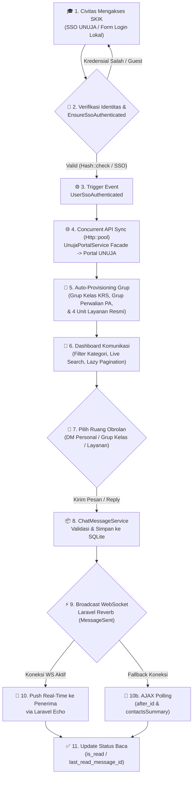

# 💬 SKIK UNUJA — Sistem Komunikasi Internal Kampus

<p align="center">
  
  
  
  
  
  
</p>

---

## 📌 Tentang Aplikasi

**SKIK UNUJA (Sistem Komunikasi Internal Kampus)** adalah layanan komunikasi internal (*Communication Service*) berbasis web untuk civitas akademika **Universitas Nurul Jadid (UNUJA)** yang menyatukan interaksi antara mahasiswa, dosen, dan unit layanan resmi kampus dalam satu platform *real-time* yang terverifikasi.

Sistem ini terintegrasi langsung dengan **REST API SSO & Portal Akademik UNUJA** untuk membentuk direktori kontak resmi serta grup kelas mata kuliah (berbasis KRS aktif) dan grup perwalian (Dosen PA) secara otomatis—sehingga komunikasi akademik berjalan tertib tanpa perlu membagikan nomor telepon pribadi.

---

## 🔄 Alur Kerja Sistem (Autentikasi, Sinkronisasi KRS & Real-Time Chat)



> 🛡️ **Proteksi Keamanan & Privasi:** Akses `/dashboard` dan seluruh *endpoint* JSON dilindungi *middleware* `EnsureSsoAuthenticated` (redirect `302` untuk browser, `401 Unauthorized` untuk AJAX). Kredensial API kampus (`UNUJA_DEV_ID` & `UNUJA_X_TOKEN`) terisolasi di `.env` via `config/services.php` (0 *hardcoded secrets*), dan seluruh *route* pintasan `/dev/login` dikunci khusus pada lingkungan `APP_ENV=local`.

---

## ✨ Fitur Unggulan Berdasarkan Peran & Modul

### 1. 🎓 Portal Mahasiswa
* **Autentikasi Terintegrasi:** Masuk melalui SSO UNUJA atau form `/login` lokal berbasis NIM dengan verifikasi *hash bcrypt* (`Hash::check`).
* **Grup Kelas & Perwalian Otomatis:** Otomatis tergabung ke seluruh grup mata kuliah sesuai KRS semester aktif dan grup Perwalian bersama Dosen PA hasil sinkronisasi API UNUJA.
* **Direktori Kontak Lintas Peran:** Filter cepat (`Semua`, `Dosen`, `Mahasiswa`, `Layanan`, `Grup`) dan pencarian AJAX instan berdasarkan nama, NIM, NIDN, maupun nama mata kuliah.
* **Akses Layanan Satu Pintu:** Terhubung langsung ke 4 kanal layanan resmi kampus (**BAAK**, **BAU**, **Fakultas Teknik**, dan **PDSI**).

### 2. 👨‍🏫 Portal Dosen (Pengampu & Pembimbing Akademik)
* **Sinkronisasi Kelas Ampuan:** Otomatis terhubung dengan seluruh mahasiswa pada kelas yang diampu dan mahasiswa bimbingan perwalian (PA) pada tahun akademik aktif.
* **Komunikasi Tanpa Nomor Pribadi:** Berinteraksi melalui identitas resmi NIDN/NIP sehingga privasi kontak pribadi tetap terjaga.
* **Pemantauan Anggota Grup:** Akses modal daftar anggota grup lengkap dengan fitur *live search* sisi klien berdasarkan nama atau NIM.

### 3. 🏢 Portal Unit Layanan Resmi (4 Unit Kampus)
* **Kanal Terstruktur:** Menyediakan akun layanan resmi (`unit_baak`, `unit_bau`, `unit_ft`, `unit_pdsi`) yang dibuat melalui *seeder* idempoten (`firstOrCreate`).
* **Prioritas Percakapan & Unread Badge:** Daftar *sidebar* otomatis menempatkan percakapan terbaru di posisi teratas lengkap dengan indikator jumlah pesan belum dibaca.

### 4. ⚡ Pengalaman Percakapan Real-Time & UX Modern
* **WebSocket Real-Time + Fallback:** Pengiriman pesan instan melalui server terpisah **Laravel Reverb + Laravel Echo**, didukung *fallback* AJAX polling (`after_id`) dan muat riwayat pesan lama (`before_id`).
* **Balas Pesan (Reply):** Mendukung kutipan pesan spesifik (`reply_to_id`) baik pada ruang DM maupun ruang Grup.
* **Perlindungan Race Condition & Navigasi Cepat:** Perpindahan tab filter dan *lazy-load pagination* (40 kontak/halaman) dilindungi `AbortController` + *sequence token*, serta dukungan tombol `Esc` untuk menutup ruang obrolan seketika tanpa *reload*.

---

## 🗄️ Arsitektur Modular & Database Terisolasi

SKIK dirancang dengan pola **Modular Monolith** (sebagai *Communication Service* dalam ekosistem terdistribusi UNUJA) agar batas tanggung jawab antar-layanan bersih dan bebas *circular dependency*:

### A. Pemisahan Layanan Backend (`app/Services/`)

| Modul / Service | Lokasi | Peran & Tanggung Jawab |
| :--- | :--- | :--- |
| **Thin Controller** | `ChatController.php` (225 baris) | Validasi HTTP request, otorisasi target, dan delegasi 6 *route* utama. |
| **Chat Directory Service** | `app/Services/Chat/ChatDirectoryService.php` | Penyusunan daftar kontak *sidebar*, filter kategori, *pagination* konsisten, skor relevansi pencarian, *unread count*, dan anggota grup. |
| **Chat Message Service** | `app/Services/Chat/ChatMessageService.php` | Riwayat 50 pesan, *pagination* `before_id`/`after_id`, penyimpanan DM & grup, *reply*, pembaruan status baca, dan *broadcast* Reverb. |
| **UNUJA Integration Layer** | `app/Services/UnujaPortalService.php` + 4 service di `app/Services/Unuja/` | Pola *Facade* untuk membungkus `UnujaApiClient` (`Http::pool`), `UnujaProfileService`, `UnujaKrsSyncService`, dan `UnujaPerwalianSyncService`. |

### B. Struktur Database Terisolasi (SQLite — 11 Tabel Aktif)

Seluruh 19 tabel *legacy* yang tidak terpakai telah dibersihkan. Database lokal kini hanya menampung 11 tabel domain komunikasi, sementara data sumber akademik tetap dikelola oleh layanan eksternal Portal UNUJA:

| Kelompok Tabel | Nama Tabel | Peran & Isi Data |
| :--- | :--- | :--- |
| **Master & Cache Identitas (7 Tabel)** | `users`, `roles`, `fakultas`, `program_studi`, `tahun_akademik`, `unit_kampus`, `jenis_grup` | Cache profil civitas (NIM, NIDN/NIP, username, *hash password*), peran (`Mahasiswa`, `Dosen`, `Staff_Unit`, `Admin`), metadata akademik, dan 4 unit layanan resmi. |
| **Transaksi Komunikasi (4 Tabel)** | `groups`, `group_members`, `messages`, `group_messages` | Metadata grup kelas/perwalian, keanggotaan & `last_read_message_id`, serta pesan DM/Grup lengkap dengan `reply_to_id` dan `is_read`. |

---

## 🚀 Panduan Instalasi (Quick Start)

Ikuti langkah-langkah berikut untuk menjalankan proyek di komputer lokal Anda:

### 1. Kebutuhan Sistem
* **PHP >= 8.2** (disarankan **PHP 8.4** dengan ekstensi `pdo_sqlite`, `mbstring`, `openssl`, `curl`)
* **Composer >= 2.x**
* **Node.js >= 18.x** & **NPM**
* **Laravel Herd / XAMPP / PHP Built-in Server**

### 2. Kloning Repositori
```bash
git clone [https://github.com/mochammadfarhan1611-max/sistem-komunikasi-internal-kampus.git](https://github.com/mochammadfarhan1611-max/sistem-komunikasi-internal-kampus.git)
cd sistem-komunikasi-internal-kampus
```

### 3. Instal Dependensi
```bash
# Instal dependensi PHP
composer install

# Instal dependensi Frontend
npm install
```

### 4. Konfigurasi Lingkungan (`.env`)
Salin file konfigurasi lingkungan dan buat *application key*:
```bash
cp .env.example .env
php artisan key:generate
```

Pastikan pengaturan *database* SQLite, Reverb, dan kredensial API UNUJA pada `.env` sudah terisi:
```env
APP_ENV=local
DB_CONNECTION=sqlite

BROADCAST_CONNECTION=reverb
REVERB_APP_ID=...
REVERB_APP_KEY=...
REVERB_APP_SECRET=...

UNUJA_SSO_BASE_URL=https://...
UNUJA_APP_ID=...
UNUJA_DEV_ID=...
UNUJA_X_TOKEN=...
```

### 5. Migrasi & Seeder Database
Buat file SQLite (jika belum ada) lalu jalankan migrasi beserta *seeder* idempoten:
```bash
php artisan migrate --seed
```

### 6. Kompilasi Aset & Jalankan Server
Bangun aset *frontend* lalu jalankan server web Laravel bersamaan dengan server WebSocket Reverb (atau cukup jalankan skrip `jalankan.bat` di Windows):
```bash
# Kompilasi aset frontend
npm run build

# Terminal 1 — Jalankan Web Server Laravel
php artisan serve

# Terminal 2 — Jalankan WebSocket Server Laravel Reverb
php artisan reverb:start
```

Buka peramban (*browser*) dan akses: **`http://127.0.0.1:8000`**

---

## 🔑 Akun Uji Coba (Demo Login Lokal)

Pada lingkungan pengembangan lokal (`APP_ENV=local`), akun hasil *seeder* maupun sinkronisasi API menggunakan *identifier* masing-masing (`NIM` / `NIDN` / `username`) yang tersimpan dalam bentuk *hash bcrypt* sah di SQLite lokal:

| Role / Peran | Identitas (`NIM` / `NIDN` / `Username`) | Password Lokal | Keterangan |
| :--- | :--- | :--- | :--- |
| **Mahasiswa** | `2421400177` | `2421400177` | Mahasiswa Aktif Teknik Informatika (Fakultas Teknik) |
| **Dosen** | `<NIDN_DOSEN>` *(sesuai hasil sinkronisasi API)* | `<NIDN_DOSEN>` | Dosen Pengampu Mata Kuliah & Dosen Wali (PA) |
| **Unit BAAK** | `unit_baak` | `unit_baak` | Biro Administrasi Akademik dan Kemahasiswaan |
| **Unit BAU** | `unit_bau` | `unit_bau` | Biro Administrasi Umum & Keuangan |
| **Unit FT** | `unit_ft` | `unit_ft` | Layanan Resmi Fakultas Teknik |
| **Unit PDSI** | `unit_pdsi` | `unit_pdsi` | Pusat Data dan Sistem Informasi |

> 💡 **Pintasan Cepat (Hanya Aktif saat `APP_ENV=local`):** Anda dapat mengakses langsung URL *dev login* berikut saat server lokal aktif untuk mempermudah pengujian *real-time chat* dua arah di jendela Incognito (otomatis mengembalikan `404` pada mode *production*):
> * Mahasiswa: `http://127.0.0.1:8000/dev/login/2421400177/mahasiswa`
> * Layanan BAAK: `http://127.0.0.1:8000/dev/login/unit_baak/staff_unit`
> * Layanan FT: `http://127.0.0.1:8000/dev/login/unit_ft/staff_unit`

---

## 🧪 Pengujian Otomatis (Testing)

Aplikasi dilengkapi pengujian fitur dan unit (*PHPUnit*) yang berjalan terisolasi menggunakan SQLite `:memory:` serta `Http::fake()` tanpa ketergantungan jaringan eksternal, mencakup alur autentikasi, proteksi *middleware*, pengiriman pesan AJAX, *polling*, serta pengurutan kontak *sidebar*:

```bash
# Menjalankan seluruh rangkaian tes otomatis
php artisan test --compact
```

*(Seluruh **16 tes otomatis / 112 assertions** terverifikasi 100% lulus / Passed).*

---

## 🏛️ Pengembang

Dikembangkan oleh **Mochammad Farhan** (`2421400177`)  
Program Studi Teknik Informatika — Fakultas Teknik  
**Universitas Nurul Jadid (UNUJA)**  
Karanganyar, Paiton, Probolinggo, Jawa Timur.